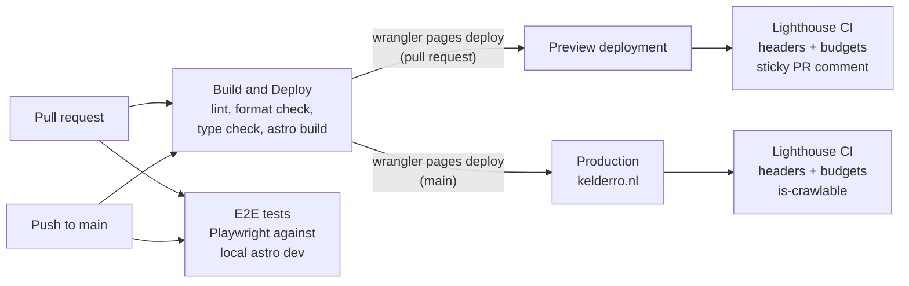

# 🚀 Portfolio & Business Website

[](https://github.com/Kelderro/kelderro.nl/actions/workflows/ci.yml)
[](LICENSE)

[](https://scorecard.dev/viewer/?uri=github.com/Kelderro/kelderro.nl)

This is the portfolio and business website for my freelance technical consulting and principal engineering company. Built with [Astro](https://astro.build), it showcases my experience, skills, and services.

## ✨ Features

- Modern, fast, and SEO-friendly static site using Astro
- Content-driven: MDX for engagements
- Responsive design and custom components
- Cloudflare Pages deployment for global speed and reliability
- Opt-in Sentry error monitoring (only bundled when a DSN is configured)
- DevContainer support for consistent development environments

## 🛠️ Development & Usage

### Prerequisites

- [pnpm](https://pnpm.io/) (recommended)
- [Docker](https://www.docker.com/), [Podman](https://podman.io/), or any compatible container runtime (for DevContainer)

### 🧪 Automated Testing

End-to-end and integration tests are written with [Playwright](https://playwright.dev/).

- Test files are located in the `tests/` directory.
- To run tests:
    ```sh
    pnpm test
    ```

### 📝 License

**Code (Technical Aspects):**
All code in this repository is licensed under the MIT License. You are free to use, modify, and reuse any technical or code aspects of this project, including for commercial purposes.

**Content (Text, Images, Portfolio Items):**
All written content, images, and portfolio items are licensed under the Creative Commons Attribution-NonCommercial 4.0 International (CC BY-NC 4.0) license. You may not copy the content one-to-one or use it for commercial purposes, but you may take inspiration for your own projects.

See the [LICENSE](LICENSE) file for full details.

### Getting Started (with DevContainer)

1. Open the project in VS Code and reopen in DevContainer when prompted.
2. Install dependencies:
    ```sh
    pnpm install
    ```
3. Start the local development server:
    ```sh
    pnpm run dev
    ```
4. Visit the local site at the URL shown in the terminal (e.g., http://localhost:4321).

### Running Locally (without DevContainer)

1. Clone the repository
2. Install dependencies with `pnpm install`
3. Run `pnpm run dev`

### Build for Production

```
pnpm run build
```

### Preview Production Build

```
pnpm run preview
```

## 🏗️ Architecture

The site is a static Astro build, deployed to Cloudflare Pages by GitHub Actions. Every pull request gets a preview deployment, which Lighthouse audits before merge. Every push to `main` deploys production, which Lighthouse audits again.



- **Astro, static output.** Pages are built ahead of time, with a hash-based Content-Security-Policy per page. Content lives in MDX under `src/content/`. See [ADR 0005](docs/adr/0005-astro-static-build.md).
- **Cloudflare Pages.** CI builds once and deploys that build. Pages' own production builds are off. Pages still builds previews as an extra check. Dependabot and fork pull requests get no preview, because the deploy needs secrets. See [ADR 0006](docs/adr/0006-cloudflare-pages-hosting-and-previews.md).
- **CI verifies, never rewrites.** Lint and formatting are fixed locally by the pre-commit hook. CI only checks, so required checks always report on the PR's HEAD. See [ADR 0008](docs/adr/0008-ci-verifies-never-rewrites-pr-head.md).
- **Lighthouse on previews and production.** Core Web Vitals, page weight and third-party budgets, plus a check of the security headers in `public/_headers`. See [ADR 0009](docs/adr/0009-lighthouse-on-previews-and-production.md).
- **Sentry is opt-in.** The SDK is only bundled when `PUBLIC_SENTRY_DSN` is set. See [ADR 0007](docs/adr/0007-sentry-is-opt-in.md).
- **Cookieless analytics.** Cloudflare Web Analytics in production builds only, with no consent banner needed. See [ADR 0002](docs/adr/0002-cookieless-analytics-without-consent-banner.md).
- **Infrastructure as code.** The Pages project, DNS and zone settings are managed with OpenTofu in [`infra/`](infra/README.md). See [ADR 0003](docs/adr/0003-manage-cloudflare-with-opentofu.md).
- **DevContainer** for a consistent, reproducible development environment.

All decisions are listed in [`docs/adr/`](docs/adr/README.md).

## 🌐 Deployment

GitHub Actions deploys the site to Cloudflare Pages on every push to `main`, after the build has been linted, type-checked and built. Pull requests from this repository get a preview deployment.

## Credits

- Based on the [Astro Starter Kit: Portfolio](https://github.com/withastro/astro/tree/latest/examples/portfolio)
